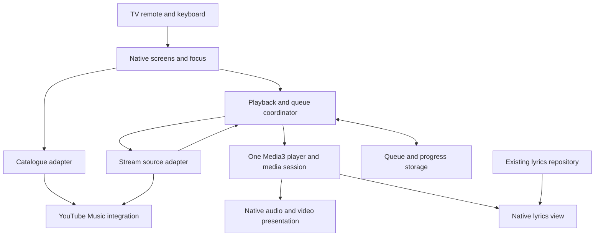

# Native TV Music App Proposal

Prepared 14 November 2026 for the TCL Android TV 11 and development on a laptop with 8 GB RAM or less.

## Recommendation

Build a native Android TV client with native search, navigation, playback controls, queue editing, and lyrics. Use Android Media3 for audio/video playback and a replaceable YouTube Music integration for catalogue data and playable sources. The app will own playback and its active queue, rather than trying to click the website's controls.

Keep the existing charcoal, ivory, and gold listening-room design. Rebuild its interactions around a five-way remote: a visible focus indicator, predictable Back behavior, large action targets, and focus restoration. The normal experience will have no mouse cursor and no YouTube Music page loaded behind it. A temporary account window can remain for sign-in.

**First implementation milestone: prove native YouTube playback and account access on this TV before a large UI rewrite.** Native screens and queue operations are straightforward platform work; reliable source resolution, authenticated access, and audio/video representations are the dependencies that could change the project plan.

## What the app should feel like

| Screen | Proposed behavior |
| --- | --- |
| Home and Library | Native rows and lists for albums, playlists, recent items, and supported account content. A mini-player remains accessible while browsing. Personal recommendations are included only where the provider exposes them. |
| Search | Native text entry with the TV keyboard, suggestions, filters, paged results, and cancellation of stale requests. Query, scroll position, and focused result survive a trip to playback. An on-screen microphone action can use speech input if available; ordinary text search always works. |
| Track actions | OK plays the focused result. A visible Actions button exposes Play next, Add to queue, and artist/album navigation. Menu or long OK may be shortcuts, but neither is required. |
| Now Playing | Large Previous, Play/Pause, Next, seek rail, elapsed/total time, Lyrics, Queue, and Audio/Video controls. Show buffering, failures, and unavailable modes directly. |
| Lyrics | Preserve the current split artwork/lyrics layout, type hierarchy, active-line marker, and gentle line movement. Support manual browsing, line seeking, and Follow song. |
| Queue | Show the current track separately from upcoming entries. Play, move, remove, and clear upcoming music with the remote. Queue editing leaves the current track playing. |
| Settings and Account | Playback preference, supported quality choices, remote shortcuts, accessibility/motion preferences, and account management. Background audio is an explicit preference. |

Playback continues while navigating inside the app. By default, leaving the whole app for the TV launcher pauses playback, matching the current app. This is an explicit app policy, not MediaSessionService's default. An optional background-audio setting requires the foreground media-playback service configuration and notification; video resources are released when the UI is absent. [MediaSession service lifecycle](https://developer.android.com/media/media3/session/background-playback)

## Remote controls

These are proposed defaults. The first hardware check must establish which physical TCL buttons actually reach an app; some are consumed by the TV or HDMI system. Every essential action also has an on-screen control usable with D-pad, OK, and Back. Android's controller guidance supports designing around that minimum set. [Android TV controllers](https://developer.android.com/training/tv/get-started/controllers)

| Input | Proposed action |
| --- | --- |
| D-pad | Move visible focus. On the seek rail, Left/Right seeks in 10-second steps; in queue Move mode, Up/Down chooses placement. |
| OK | Activate the focused control. On a search result, Play now. In a track's Actions menu, perform the selected action. In Move mode, commit placement. |
| Back | Close the keyboard, action sheet, or editing mode first; otherwise return one screen and restore focus. At the root screen, return to the TV launcher. |
| Channel + / Channel − | Next / previous queue item, if delivered by this remote. One action per press; holding the key does not skip dozens of tracks. |
| Media Next / Previous | The same track-change commands as the on-screen buttons. Previous means the previous entry; Restart is a separate action. |
| Play/Pause | Toggle playback through the Android media session. |
| Fast-forward / Rewind | Relative seeking. Held seeking can accelerate when supported by the remote. |
| Menu or long OK | Optional shortcut to the focused track's Actions menu. The visible Actions button remains available. |
| Dedicated Forward, if present | Optional forward navigation through retained screen history. It is separate from seeking and track changes. |
| Home, volume, power, voice-assistant keys | Remain system controls. An app microphone button is separate from the TV's assistant key. |

Media buttons have one handler through MediaSession; channel shortcuts invoke the same queue commands. This avoids one press being handled twice. Text entry and modal controls take precedence over ordinary focus shortcuts.

## Queue behavior

The queue belongs to this TV session. Editing it does not silently edit a saved YouTube playlist or another device's queue.

- **Play now:** for a single search result, insert and start it while keeping upcoming entries. Playing a whole album or playlist explicitly offers replacement or appending.
- **Play next:** insert immediately after the current entry. A later Play next request becomes the immediate next item; inserting a collection preserves that collection's order.
- **Add to queue:** append without changing playback.
- **Reorder:** focus an upcoming row, choose Move, press Up/Down to preview its position, and press OK to commit. Back cancels the draft. The current track stays pinned and its playback position is preserved.
- **Remove:** remove an upcoming entry and offer Undo. Removing the current track is a separate Skip and remove action.
- **Restore:** persist queue entries, current entry, playback position, mode, shuffle, and repeat. On restart, offer Resume without unexpected autoplay.
- **Duplicates and shuffle:** repeated songs have different queue-entry IDs. The queue shows actual upcoming playback order; Play next and manual moves must work with shuffle without randomly rebuilding the order.

Retain played entries/history so Previous remains available even though the main queue panel emphasizes current/upcoming music. Persist explicit shuffle traversal keyed by entry IDs, not just a random seed: Media3's base playlist indices are not its shuffled traversal order. The coordinator must update that order for Play next and Move. If playback advances during a reorder draft, revalidate the entry IDs at commit and cancel or rebase a move that would affect the newly playing entry.

Example: A is playing and B, C are upcoming. Choosing Play next for D gives A → D → B → C. Adding E gives A → D → B → C → E. Moving C above B changes only the upcoming order.

One coordinator serializes all mutations onto the player's application thread. Media3's live playlist is authoritative; screens display its state. A reorder draft is temporary UI state, not a second live queue. Stable entry IDs prevent a track transition or two identical songs from making an edit target the wrong row. Media3 supports inserting, moving, removing, and replacing playlist entries during playback. [Media3 playlists](https://developer.android.com/media/media3/exoplayer/playlists)

## Native architecture

| Component | Proposed choice |
| --- | --- |
| TV interface | Android Views and RecyclerView, with explicit focus groups and restoration. Keep the existing Java code where practical; isolate Kotlin interop in the provider adapter if required. |
| Playback | One ExoPlayer and MediaSession in an in-process MediaSessionService. Use a SurfaceView for video and hardware-supported codecs. |
| Catalogue and sources | Separate interfaces for search/browse/account data and for playable audio/video sources. A backend replacement should not require rewriting TV interactions. |
| Queue and storage | One playback coordinator, native playlist operations, and platform SQLite or a small transactional store for queue/history/settings. Persist track identifiers, not expiring signed stream URLs. |
| Lyrics | Reuse the bounded lyric provider, matching rules, incomplete-timing safeguards, and design. Present synchronized lines with native recycled views driven by Media3 position. |
| Authentication | Reuse the successful account-window approach where supported. Prove a scoped native-client session separately; a signed-in WebView does not automatically authenticate a new HTTP client or Media3. |

Google recommends Compose for new TV interfaces. Views plus RecyclerView is the proposed choice for this existing Java project so the playback rewrite does not also require replacing the entire UI toolchain. This is not a claim that Compose is inherently slower. Do not introduce deprecated Leanback for a new implementation. [TV development guidance](https://developer.android.com/training/tv/get-started/create), [Leanback status](https://developer.android.com/jetpack/androidx/releases/leanback)

Start with packages inside the app, not many Gradle modules. Add only the Media3 playback/session/UI components and transports actually required. SurfaceView is the initial video choice because Android documents power and frame-timing advantages. [Media3 surfaces](https://developer.android.com/media/media3/ui/surface)

## YouTube Music integration and the Cliamp comparison

Cliamp is a useful architectural reference. Its desktop YouTube Music integration obtains catalogue/library metadata through read-only YouTube Data API calls or a browser-session-backed provider; actual audio uses a separate yt-dlp/ffmpeg pipeline. Its terminal UI and subprocess player are not the Android TV implementation we should port. [Cliamp integration](https://github.com/bjarneo/cliamp/blob/main/docs/youtube-music.md), [playback implementation](https://github.com/bjarneo/cliamp/blob/fce2f93752ad96eb221e1e66ecab913b26f88c2b/player/ytdl.go)

**Preferred candidate to evaluate: InnerTubeX behind our own adapter.** It exposes YouTube Music catalogue/account operations and source extraction. It uses private interfaces and experimental versioning, so selection depends on real hardware results. NewPipeExtractor is a Java alternative for public Music search and stream extraction; authenticated Music-library coverage needs a separate assessment. [InnerTubeX](https://github.com/MetrolistGroup/innertubex), [NewPipeExtractor](https://github.com/TeamNewPipe/NewPipeExtractor)

Three conditions must be resolved before committing to a backend:

1. **Playback and account capabilities:** demonstrate real audio, video, seeking, expiring-source recovery, and access to this user's library. InnerTubeX's SABR transport returns byte/chunk streams rather than a ready Media3 URL or MediaSource; prove a bounded Media3 transport adapter, or reliably usable direct/HLS alternatives. This is integration work, not simply assigning a returned URL. The current app's login does not establish native-client account, upload, region, or subscription capabilities. Obtain required session data through the app's own account flow, scope it to the integration, and keep it out of logs. Playback must run on the TV without a laptop relay or mandatory home server. [SABR stream interface](https://github.com/MetrolistGroup/innertubex/blob/v0.11.7/src/commonMain/kotlin/com/metrolist/innertubex/sabr/SabrAudioStream.kt)
2. **Build and runtime compatibility:** InnerTubeX v0.11.7's source build uses compile SDK 37, AGP 9.4.1, Kotlin 2.4.21, and a JDK 21 toolchain; this project currently uses SDK 35, AGP 8.7.3, and JDK 17. Inspect the published Android variant, AAR/Kotlin metadata, bytecode compatibility, and transitive dependencies before choosing a toolchain change or rebuilding its multiplatform project. Likewise, select a compatible stable Media3 release after checking requirements. [InnerTubeX versions](https://github.com/MetrolistGroup/innertubex/blob/v0.11.7/gradle/libs.versions.toml), [build configuration](https://github.com/MetrolistGroup/innertubex/blob/v0.11.7/build.gradle.kts), [Media3 releases](https://developer.android.com/jetpack/androidx/releases/media3)
3. **Distribution license:** InnerTubeX and NewPipeExtractor declare GPLv3. Adopting them needs a GPL-compatible distribution and corresponding-source plan before distributing the combined app. No license change or source publication is part of this proposal. Cliamp's desktop project is MIT; its separately linked Android project, Kleeamp, has a different, restrictive license and is not a ready MIT-licensed YouTube Music base. [InnerTubeX license](https://github.com/MetrolistGroup/innertubex/blob/v0.11.7/LICENSE), [NewPipeExtractor license](https://github.com/TeamNewPipe/NewPipeExtractor/blob/dev/LICENSE), [Cliamp license](https://github.com/bjarneo/cliamp/blob/main/LICENSE), [Kleeamp license](https://github.com/cliamp/kleeamp/blob/main/LICENSE)

Token handling is also part of the source test. InnerTubeX's default token provider returns no proof-of-origin token; this does not establish that playback will work without one on our TV/network. Determine whether an additional provider is required and measure its cost before selecting the integration. [Token-provider contract](https://github.com/MetrolistGroup/innertubex/blob/v0.11.7/src/commonMain/kotlin/com/metrolist/innertubex/extraction/TokenProvider.kt)

## Audio and video switching

The initial Audio/Video toggle should change representations of the same recording, preserving position and paused state. Audio mode requests audio-only media and disables video decoding. Covering a video surface is insufficient; a multiplexed source may still transfer video bytes. [Media3 track selection](https://developer.android.com/media/media3/exoplayer/track-selection)

An album song and its music video can be different recordings with different intros, cuts, and duration. Treat a counterpart as a separate version unless timeline alignment is established. Do not promise a seamless jump based only on matching titles. If video is unavailable, keep audio playing and explain that on the control.

## Preserve the lyrics experience

Keep the current artwork split, readable text, active-line emphasis, progress display, and recording-matching safeguards. Rebuild the line presentation natively; Braccato's JavaScript/DOM renderer cannot simply become a native TextView. An isolated lyrics-only renderer could be a temporary migration aid, but the proposed final lyrics view is native.

Only visible lines need views. Sample the media clock while lyrics are visible and playback is running; paused seeks update from player events. Animate line changes rather than running permanent effects. Entering manual lyric browsing pauses following; OK seeks to the selected timed line, and Follow song resumes it and returns focus to a fixed playback control. Missing or incomplete timing uses the existing honest plain-text fallback.

## Efficiency and hardware gates

Keep Gradle at one worker, a 1 GB JVM heap, and no persistent daemon. If Kotlin compilation is introduced, include its compiler process in the laptop's total memory budget; the Gradle heap is not a total RAM limit. Use the physical TV and offline UI fixtures rather than an emulator. Prefer published dependencies to compiling whole phone apps or multiplatform workspaces. Do not bundle a desktop Go/Python/ffmpeg playback stack.

Use one player, bounded media/image caches, paged lists, cancellation of stale requests, and prefetch at most the next item's source. Refresh expired media URLs with bounded retries; retain the queue and position and expose Retry/Skip instead of an endless spinner. No playback work or decoding is performed through the Music website.

These are proposed acceptance targets, not measurements of a native build:

- D-pad focus response p95 below 100 ms on this TV; aim for the display's UI refresh budget, approximately 16.7 ms at 60 Hz.
- No unbounded memory growth or low-memory kill during 30–60 minutes of playback, browsing, queue edits, and repeated mode changes.
- Record TV RAM, low-RAM classification, codec support, graphics/media buffers, native allocations, and any account/token renderer process. Use Android's memory categories rather than equating a category target with total app PSS.
- Stop lyric timers when hidden or paused, release video resources when unused, and destroy the account window on return.

A native player will have a larger dependency footprint than the current tiny wrapper APK. Its success is measured by usable controls, resource use, and sustained playback—not APK size alone. [Android TV memory guidance](https://developer.android.com/training/tv/playback/memory)

## Delivery sequence

| Stage | Deliverable and exit condition |
| --- | --- |
| 1. Feasibility | A small native playback screen on this TV. Resolve and play representative real tracks through Media3, prove the required transport/seek adapter, play the next item, test usable audio/video sources, and prove native account-library access. Record remote key codes and dependency/build cost. Metadata or stream listings alone do not pass this gate. Select or reject the backend here; estimate substantial custom transport work before undertaking it. |
| 2. Native interaction shell | Home, Search, results, Now Playing, and persistent mini-player using fixture/local media. Every action works with D-pad/OK/Back, and returning restores query, scroll, and focus. |
| 3. Queue | Play now/next, append, remove/Undo, Move mode, shuffle/repeat, next/previous media and channel buttons, and persisted restoration. Edits preserve the playing item and position. |
| 4. Connected browsing | Wire native search, pagination, albums/playlists, supported account library, cancellation, and error states to the selected adapter. Start playing and resolve the next item without blocking navigation. |
| 5. Lyrics and modes | Native listening room, manual line seeking/Follow, correct clock handling, and same-recording audio/video switching. Test unavailable and different-recording cases. |
| 6. Hardware qualification | Network loss, expired sources, rapid skips, duplicate entries, queue edits during track transitions, Home/resume, process restart, decoder failures, and sustained memory/frame testing. |

Keep v0.5 available for rollback while developing a native preview behind an explicit entry point in the same app package, with a compatible signing identity and retained app data/WebView profile. This preserves the stored browser profile; native-client authorization still needs its own proof. A separately installed package would need its own sign-in. The native path must never silently substitute the website player. Cut over the default launcher only when the essential flows and hardware gates pass.

## Completion criteria

- Search with the remote, play a result, return, and land on the same result with the query preserved.
- Queue B next and C last while A plays; move C above B with the remote without interrupting A.
- Perform next/previous from Now Playing, Lyrics, Search, and Queue with the delivered hardware keys, once per press.
- Switch audio/video for a supported recording without replacing the queue or losing position; unavailable modes remain understandable.
- Open lyrics, browse and seek a line, resume following, and return without losing playback controls.
- Access the signed-in library through the native data integration and retain the account after restart.
- Recover or fail clearly on an expired source or lost network while keeping the queue intact.
- Resume a saved queue after a restart; verify duplicate entries and shuffled order remain coherent.

The next implementation step should be Stage 1. Its result determines the provider, dependency/toolchain changes, and a grounded estimate for the rest of the rewrite.
